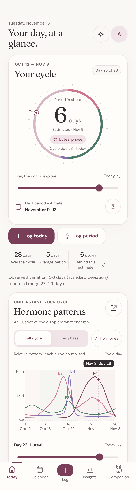
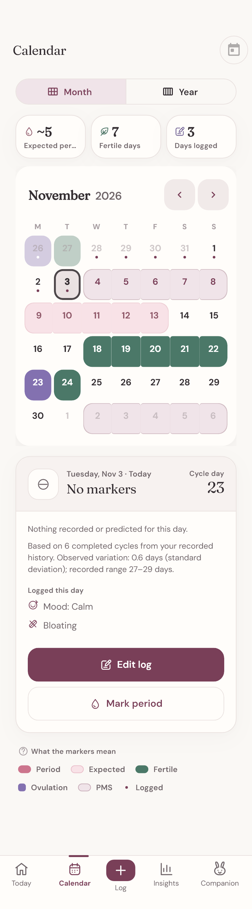
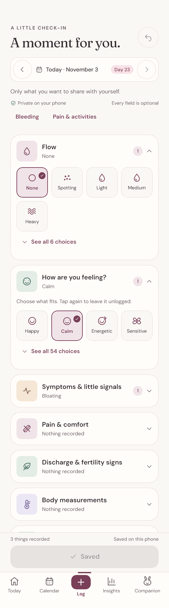
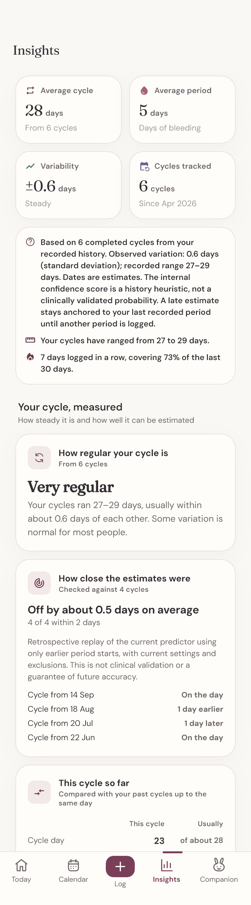

<div align="center">


### Your cycle, your way.

Period, symptom and wellbeing tracking on your device. Offline tracking needs no account.

[](https://github.com/lekhanpro/cyclecare/actions/workflows/ci.yml)
[](https://github.com/lekhanpro/cyclecare/actions/workflows/build-release.yml)
[](https://flutter.dev)
[](LICENSE)

**[Download Android APK](https://github.com/lekhanpro/cyclecare/releases/latest)** ·
[Release notes](docs/releases/2.2.0.md) ·
[All changes since v2.1.0](https://github.com/lekhanpro/cyclecare/compare/v2.1.0...v2.2.0) ·
[Commit history](https://github.com/lekhanpro/cyclecare/commits/main)

</div>

## Current Flutter interface

<div align="center">




</div>

These are actual Flutter renders with fictional records. The separate
[design handoff](redesign/README.md) documents the approved direction;
its screenshots and controls do not prove Android behavior. See
[implementation and verification details](docs/release-verification.md).

This app-first release includes the Flutter implementation, tests and design
contracts. The bulky browser prototype and research-media archive, together with
its original local commit history, remain queued for a separate upload.

## 2.3.0 review preview

The unreleased preview adds adaptive safe-area layouts and a floating navigation
bar, five tracking-mode dashboards, a ten-feature tour, record-based companion
tasks, a separate partner dashboard and optional assistant connections. See the
[preview scope and verification limits](docs/preview-2.3.0.md),
[assistant model research](docs/assistant-models.md), and
[partner setup](docs/partner/connection-setup.md). A final release awaits review;
online partner sync requires backend setup and two-device verification.

## What ships in v2.2.0

| Area | Behavior |
| --- | --- |
| Prediction transparency | Next-period estimates explain whether settings or completed history informed them, the completed-cycle count and observed variation. Late estimates remain anchored to actual recorded starts. The internal confidence heuristic is not a validated probability. |
| Cycle exclusions | Calendar period editing can exclude an unusual cycle from forecast learning, with an optional reason. Reversing the choice restores eligibility; the original health record and cycle boundaries remain. Home, Calendar and Insights share the calculation rules. |
| Historical evaluation | Insights replays the live predictor using records available before each target period. Date errors describe the available history only. [Evaluation criteria](docs/prediction-evaluation.md) gate future estimator replacements. |
| Local reminders | Period, ovulation and fertile-window reminders use the relevant estimate minus advance notice. Daily log, pill and custom reminders repeat daily. Permission requests are contextual, denial has recovery, exact-alarm restrictions use an explained approximate fallback, and failures offer retry. A test reports system acceptance; delivery remains controlled by Android. |
| Cycle-health report | Settings → Data → Cycle-health report. Choose dates and symptoms, preview, then copy or share a plain-text file. Recorded periods, intervals, variation, bleeding, pain, activity impact and existing pain-diary entries are included. Medication and reproductive observations require explicit selection; estimates have a separate optional section. |
| Bleeding and pain | Quick access from Log; nullable flow/pain distinguish unlogged from explicit none/zero. Locations and optional impact on everyday activities persist in daily logs and the existing pain diary. Care prompts link to NHS sources. |
| Symptom observations | Counts by cycle day, days before the next recorded period, and across recorded cycles expose observation counts. Blank symptom fields and unobserved cycles do not establish symptom absence. These are descriptions, not causal findings. |
| Fertility observations | Actual LH/pregnancy test results, cervical observations, BBT and optional measurement context stay local. Disturbed or unassessed measurements remain readable; descriptive temperature-rise detection uses consecutive readings explicitly marked as usual conditions. No result confirms ovulation or contraceptive safe days. |
| Offline education | All 26 existing articles and sources are preserved. The reader renders headings, lists, emphasis and callouts, with local bookmarks and reading progress. Sources show supported publisher/year metadata without inventing clinical review credentials. |
| Responsive UI | Fraunces/DM Sans, bundled semantic icons, light/dark palettes and reduced-motion controls. Regression coverage includes the Home actions/chart labels, calendar layouts and compact screens with 200% text. |

Existing features remain: the Home phase bar and all phase/window sections;
calendar month/year views; expanded grouped daily logging and custom tags;
health information and pain diary; pregnancy setup, kicks and appointments;
birth-control tracking; pet care and achievements; explicit partner snapshots;
optional PIN/biometric lock; tracking backup/restore and appearance settings.

Tracking backups contain periods, daily logs and cycle preferences. They are
separate from the scoped report and do not currently back up every auxiliary
feature store. Keep that limit in mind before replacing a device.

## Build and test

Requires Flutter **3.41.6 / Dart 3.11.4**, Java 17 and an Android SDK.
Android minimum is API 24 (Android 7.0). Compilation follows the Flutter SDK's
recommended Android SDK and NDK. Configure your machine's SDK through Flutter;
`android/local.properties` and generated plugin registration are not versioned.

```sh
flutter pub get --enforce-lockfile
flutter analyze lib test --no-pub --no-fatal-infos --no-fatal-warnings
flutter test --no-pub
flutter test --no-pub --dart-define=SHOTS=true test/shots/release_screens_shots_test.dart
npm ci --prefix test/backend/partner-db
node test/backend/partner-db/validate.mjs
flutter build apk --release --no-pub
```

Screenshot output goes to `build/shots/`. The opt-in screenshot suite is skipped
in ordinary tests and runs explicitly in CI. Behavior tests cover persistence,
exclusions, retrospective evaluation, report consent, reminders and article
preservation. UI renders test layout; device notification delivery and assistive
technology behavior require device testing too. Existing analyzer warnings and
deprecation notices are reported; analyzer errors fail CI.

No `.env` or backend account is required for local tracking. Remote AI remains
unconfigured. Optional service credentials and signing keys must never be committed.

## Releases and CI

[CI](https://github.com/lekhanpro/cyclecare/actions/workflows/ci.yml) analyzes and
tests production code, renders the final Flutter screens and builds a debug APK.
It runs for main/develop changes, Codex branches and pull requests into main.

Pushing a version tag such as `v2.2.0` runs
[Build & Release](https://github.com/lekhanpro/cyclecare/actions/workflows/build-release.yml).
It checks that the tag matches `pubspec.yaml`, runs analysis/tests/layout checks,
builds with the repository's existing signing secrets, verifies APK/AAB signatures,
and publishes APK, AAB and `SHA256SUMS.txt` together. Manual dispatch accepts an
existing version tag. Signing files are removed after the job.

Release secrets: `KEYSTORE_BASE64`, `KEYSTORE_PASSWORD`, `KEY_PASSWORD`, `KEY_ALIAS`.
Local builds without a keystore use Android's development signing configuration;
GitHub release assets use the repository's release key. Preserve that release key
so upgrades continue to read the same installed app's records.

## Architecture and design

Flutter + Riverpod + GoRouter; local persistence through SharedPreferences and
secure storage for app-lock material. The tracking domain is separated into
models, validation, prediction, analytics and report generation. Feature screens
reuse the theme, motion, icons and controls under `lib/core/theme` and `lib/widgets`.
Fonts and production artwork are bundled for offline use.

Read [DESIGN.md](DESIGN.md), [the implementation plan](redesign/IMPLEMENTATION_PLAN.md)
and [screen inventory](redesign/SCREEN_INVENTORY.md) before UI changes. Current
production status is tracked in [release verification](docs/release-verification.md).
The prototype's natural-mesh/film companion animation remains a design reference;
it is not the Flutter pet renderer. There is no wearable integration, regulated
contraceptive function, automatic partner sharing or working remote AI assistant.

CycleCare provides tracking and educational information, not diagnosis or medical
advice. Calendar dates and illustrative hormone curves are estimates/education,
not measured personal hormone levels or confirmation of ovulation.

## License

[MIT](LICENSE). Bundled fonts retain their OFL licenses. Research references and
competitor screenshots under `redesign/references` retain their original ownership
and are not production app assets.
