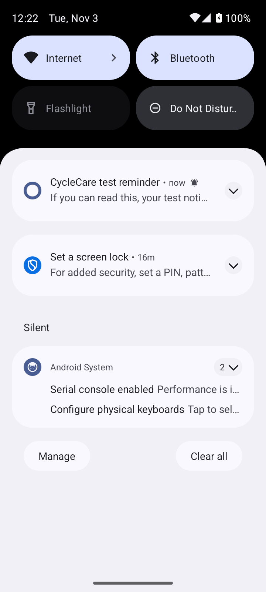

# Android emulator smoke test

On 3 November 2026, a local development-signed release APK was installed on an
Android 14 (API 34) emulator at 720×1600 pixels, using fictional test records.
Updating the APK retained onboarding and the recorded period.

The emulator returns the legacy IANA zone `Asia/Calcutta`. After the database
fix, notification initialization worked; denying permission showed the blocked
state, system-settings recovery refreshed the schedule, and Android accepted the
period reminder using approximate timing because exact alarms were unavailable.

The immediate test reported system acceptance and appeared in Android's shade:

Report preview also opened the native share sheet containing one selected
`cyclecare-health-report.txt` file. No share destination was selected.

These installed-app checks are separate from the Flutter widget captures. They
do not establish delivery under every phone's battery policy, physical-device
accessibility, or clinical validity. Published APK/AAB files are built and signed
separately by the release workflow using the repository's release key.
